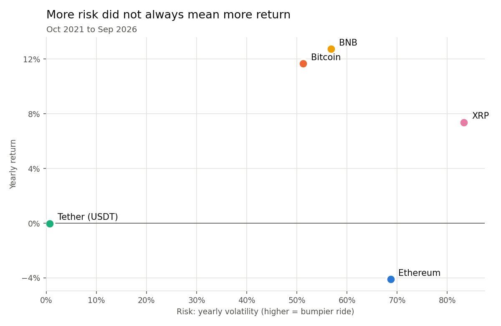

# Crypto Risk & Return

**Did the riskier coins pay off more?** A look at five years of daily prices (Oct 2021 – Sep 2026) for Bitcoin, Ethereum, Tether, BNB and XRP.

Website: https://ppc1004.github.io/crypto-risk-return/



## Key findings

| Coin | Total return | Per year | Risk (volatility) | Worst fall from peak | Sharpe ratio |
|---|---:|---:|---:|---:|---:|
| Bitcoin | +74% | +11.7% | 51% | -77% | 0.40 |
| Ethereum | -19% | -4.1% | 69% | -79% | 0.23 |
| Tether (USDT) | 0% | 0.0% | 0.7% | -1% | -5.25 |
| BNB | +82% | +12.7% | 57% | -70% | 0.43 |
| XRP | +43% | +7.4% | 83% | -76% | 0.43 |

1. **More risk did not mean more return.** XRP had the biggest swings but earned less than Bitcoin and BNB.
2. **Ethereum was riskier than Bitcoin and still lost money** over the five years.
3. **Every coin except Tether fell 70–80% from its peak**, all peaking in Nov 2021 and bottoming in 2022.
4. **Tether stayed within about 1% of $1 but earned nothing**, while 3-month T-bills paid about 3.8% a year.
5. **The coins move together** (Bitcoin–Ethereum daily correlation 0.84), so holding several did not spread risk much.

## How it works

| Step | File | What it does |
|---|---|---|
| 1 | `src/download_data.py` | Downloads daily prices for the 5 coins and the 3-month T-bill rate from Yahoo Finance into `data/raw/` |
| 2 | `src/analysis.py` | Calculates the metrics, saves tables to `outputs/`, charts to `docs/images/`, and numbers for the site to `docs/data/metrics.json` |
| 3 | `docs/` | Static website (HTML/CSS/JS) served by GitHub Pages |

### Metrics

- **Total return**: last price / first price - 1
- **Return per year (CAGR)**: (1 + total return) ^ (1 / years) - 1
- **Volatility**: standard deviation of daily returns × √365 (crypto trades every day)
- **Sharpe ratio**: (average daily return × 365 - risk-free rate) / volatility, with the risk-free rate = average 3-month T-bill yield over the same period
- **Maximum drawdown**: largest drop from a previous high
- **Correlation**: correlation of daily returns between each pair of coins

## Run it yourself

```bash
pip install -r requirements.txt
python src/download_data.py
python src/analysis.py
```

To preview the website locally: `python -m http.server --directory docs` and open http://localhost:8000.

## Project structure

```
crypto-risk-return/
├── src/
│   ├── download_data.py   # step 1: get the data
│   └── analysis.py        # step 2: metrics + charts
├── data/raw/              # downloaded prices (not uploaded to GitHub)
├── outputs/               # metrics_5y.csv, metrics_1y.csv
└── docs/                  # website (GitHub Pages)
    ├── index.html, coin.html, glossary.html
    ├── data/metrics.json
    └── images/            # 34 charts
```

## Limitations

- Past returns don't predict future prices.
- Five large coins are not the whole crypto market.
- Results depend on the window. This one starts a month before the Nov 2021 peak, which makes returns look worse than a window starting earlier would.
- Raw price data is not included in the repo; run step 1 to download it.

*An independent data analysis project, not investment advice.*

*Built with help from AI coding tools. The analysis, model choices and conclusions are my own.*
